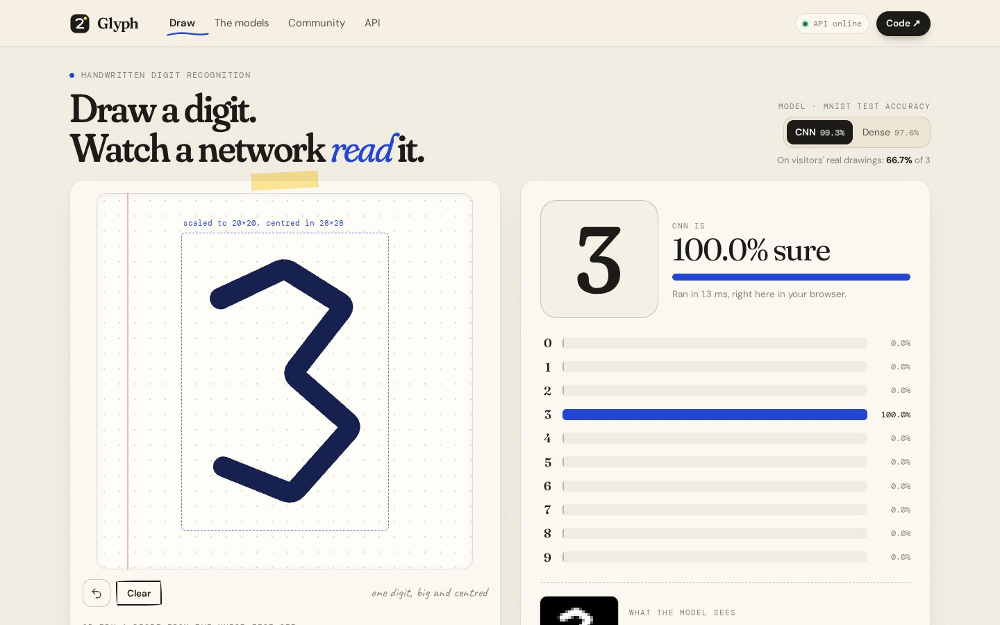
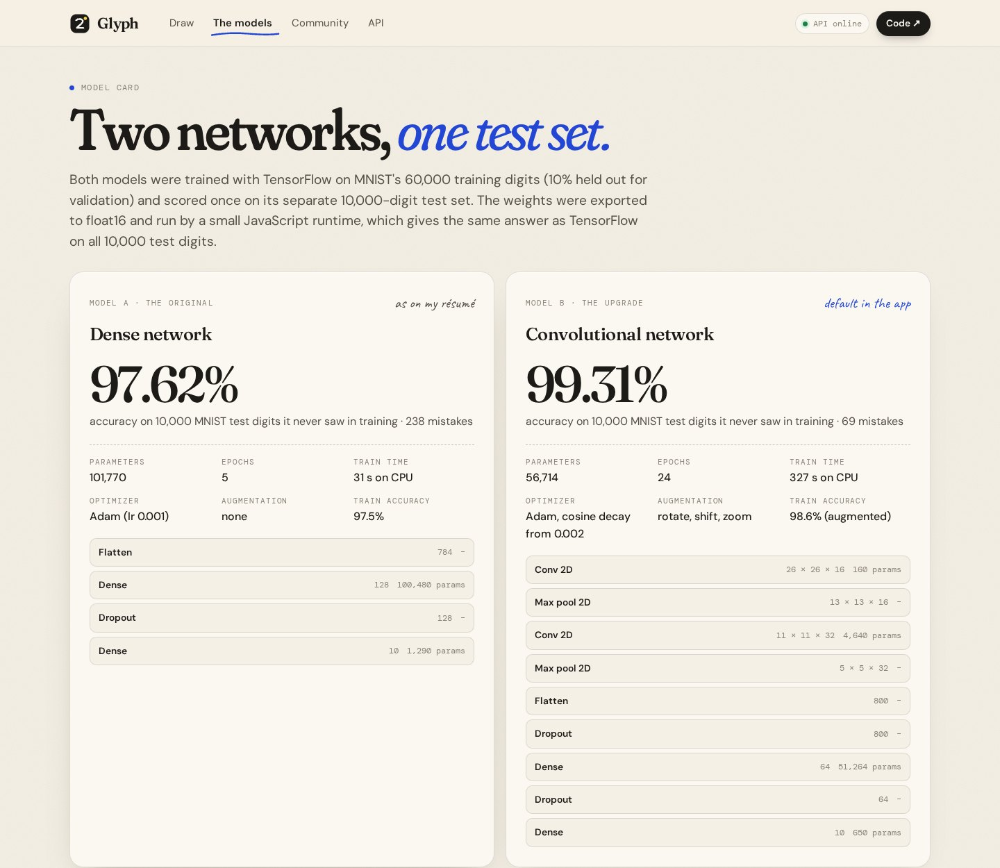
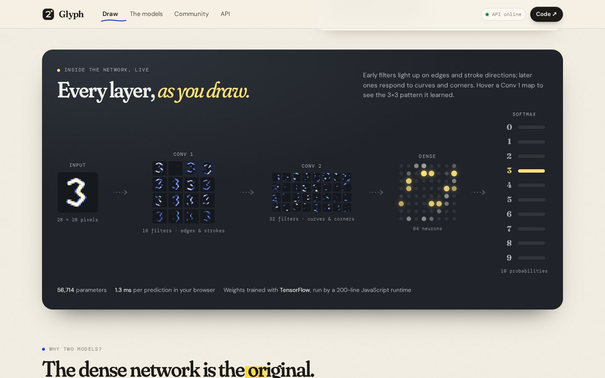
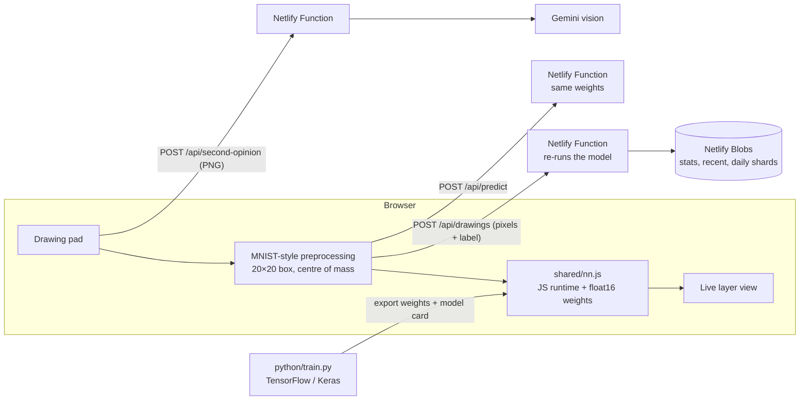
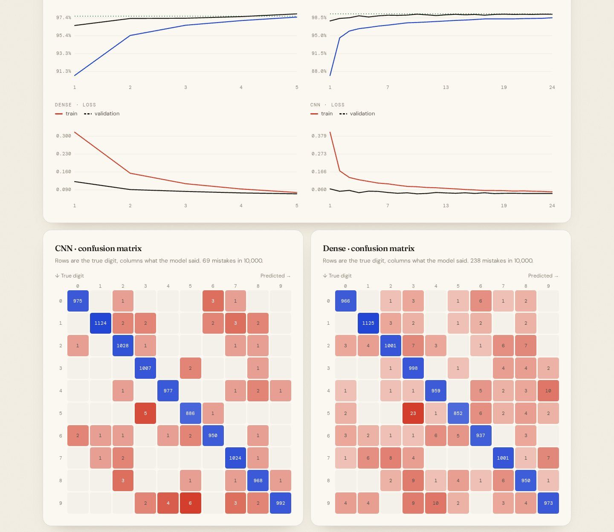

# Glyph

**Draw a digit and watch a neural network read it, layer by layer.** Two TensorFlow models trained on MNIST run live in the browser as you draw, the same weights are served through a REST API on Netlify Functions, and every drawing people label goes into a community dataset that measures how the models do on real handwriting.

**Live:** https://glyph-nishant.netlify.app &nbsp;·&nbsp; **Author:** [Nishant Singh](https://nishant-singhaa0240274.netlify.app)



## Results

| Model | Architecture | Params | MNIST test accuracy | Mistakes / 10,000 |
|---|---|---|---|---|
| Dense (the original) | 784 → Dense 128 ReLU → Dropout 0.2 → Dense 10 softmax | 101,770 | **97.62%** | 238 |
| CNN | Conv 16 → MaxPool → Conv 32 → MaxPool → Dropout → Dense 64 → Dropout → Dense 10 | 56,714 | **99.31%** | 69 |

- Trained with TensorFlow 2.21 / Keras on the 60,000 MNIST training digits (10% held out for validation), scored once on the separate 10,000-digit test set.
- **Not overfitting:** the dense model's validation accuracy tracks its training accuracy (97.9% vs 97.5%), and the CNN's training accuracy (98.6%) is *below* its validation accuracy (99.2%) because it trains on randomly rotated, shifted and zoomed digits.
- **Real-world accuracy** (digits drawn with a mouse or finger) is measured live on the Community page from visitors' feedback. It's expected to be lower than the benchmark, since screen handwriting looks different from 1990s paper forms.



## Features

- **Drawing pad** with speed-sensitive fountain-pen ink, undo, and live predictions on every stroke.
- **MNIST-style preprocessing** in the browser: the drawing is scaled into a 20×20 box, anti-aliased, and centred by its centre of mass in 28×28, exactly how MNIST was built. The app shows "what the model sees".
- **Inside the network:** feature maps from both convolution layers, dense-layer activations and the softmax output, updated as you draw. Hovering a first-layer map shows the 3×3 filter it learned.
- **Two models to compare**, with a model card: training curves, confusion matrices, per-digit accuracy and the most confident mistakes.
- **Community dataset:** people confirm or correct each prediction. The server re-runs the model itself before saving (so results can't be faked), and the Community page shows real-world accuracy, a confusion matrix of real mistakes, a live wall of drawings, and a CSV export for retraining.
- **Gemini second opinion:** sends the drawing to Gemini's vision model and shows whether a large multimodal model agrees with the small CNN.
- **Public API** for predictions, with a "try it" console.



## Architecture



| Layer | Technology |
|---|---|
| Training | Python, TensorFlow / Keras, NumPy |
| Inference | A 170-line JavaScript runtime (`shared/nn.js`: conv2d, max-pool, dense, softmax) running float16 weights exported from Keras. It's used by both the browser and the API, and there's no ML library in the bundle. |
| Frontend | React 18, Vite, Framer Motion, Canvas 2D |
| Backend | Netlify Functions (Node 22) |
| Database | Netlify Blobs |
| AI | Gemini API (multimodal), with a fallback chain across models and a per-IP rate limit |

### Checked against TensorFlow

`npm run parity` runs both exported models through the JavaScript runtime on all 10,000 MNIST test images and compares them with the Keras models:

| Model | Same digit as TensorFlow | TF accuracy | JS accuracy | Max probability gap | JS speed |
|---|---|---|---|---|---|
| Dense | 100.00% | 97.62% | 97.62% | 0.0006 | 0.1 ms / image |
| CNN | 100.00% | 99.31% | 99.31% | 0.0016 | 1.5 ms / image |



## API

| Method | Path | Description |
|---|---|---|
| `POST` | `/api/predict` | `{ "px": <base64 of 784 bytes, or array of 784 numbers>, "model": "cnn" \| "dense" }` → digit, confidence, 10 probabilities |
| `POST` | `/api/drawings` | Save a labelled drawing `{ px, label, model }`; the server recomputes the prediction |
| `GET` | `/api/stats` | Totals, real-drawing accuracy per model, confusion matrices, latest 48 drawings |
| `GET` | `/api/dataset` | All saved drawings as CSV (label, model, prediction, 784 pixels) |
| `POST` | `/api/second-opinion` | `{ image: "data:image/png;base64,…" }` → Gemini's digit, confidence and reasoning |
| `GET` | `/api/health` | Status and configuration |

```bash
curl -X POST https://glyph-nishant.netlify.app/api/predict \
  -H "content-type: application/json" \
  -d '{"model":"cnn","px":[0,0,0, ... 784 values ...]}'
```

## Run it locally

```bash
npm install
npm install -g netlify-cli
netlify dev                 # app + API + local Blobs at http://localhost:8888
```

Optional: put `GEMINI_API_KEY=...` in a `.env` file for the second-opinion feature.

Retrain and re-verify (Python 3.10+):

```bash
pip install -r python/requirements.txt
npm run train               # downloads MNIST if needed, trains both models, exports weights + model card
npm run parity              # JS runtime vs TensorFlow on the full test set
```

## Deploy (Netlify free plan)

1. Push this folder to a GitHub repository named `glyph`.
2. Netlify → **Add new project → Import an existing project → GitHub** → pick `glyph`. Build settings come from `netlify.toml`.
3. Before deploying, add the environment variable `GEMINI_API_KEY` (mark it as a secret).
4. Name the project `glyph-nishant`, deploy, then click **Make public**.

## Project structure

```
python/train.py        train both models, export weights and public/model-card.json
python/parity.py       JS runtime vs TensorFlow on all 10,000 test digits
shared/nn.js           the inference runtime (browser + API)
shared/weights/*.js    exported float16 weights
src/lib/preprocess.js  strokes → MNIST-style 28×28 image
src/components/        drawing pad, live network view, charts
src/pages/             Draw, The models, Community, API
netlify/functions/     predict, drawings, stats, dataset, second-opinion, health
netlify/lib/           Blobs storage, Gemini client, model loader
```

Dataset: MNIST by Yann LeCun, Corinna Cortes and Christopher J.C. Burges.

## License

MIT © Nishant Singh
